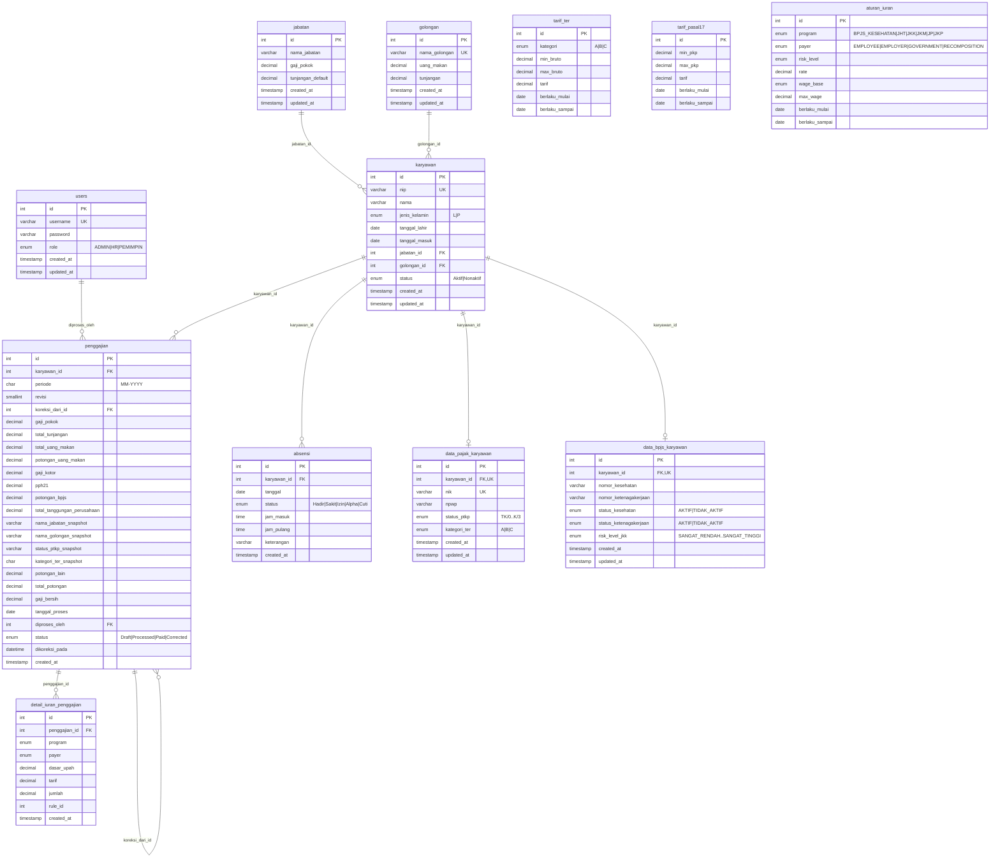

# ERD — Gajiku (penggajian_db)

> **Status:** Aktual — mencerminkan `database/schema.sql`.
> Menggantikan ERD PDF lama (`dbdiagram.io`) yang sudah outdated
> (role `ADMIN,HR` tanpa golongan/pajak/BPJS).

---

## Diagram Relasi



---

## Constraint Penting

| Tabel | Constraint | Tujuan |
|---|---|---|
| `users` | `username UNIQUE` | Cegah username ganda |
| `karyawan` | `nip UNIQUE` | Cegah NIP ganda |
| `golongan` | `nama_golongan UNIQUE` | Cegah golongan ganda |
| `absensi` | `UNIQUE(karyawan_id, tanggal)` | 1 karyawan = 1 absensi/hari |
| `penggajian` | `UNIQUE(karyawan_id, periode, revisi)` | Cegah payroll dobel (per revisi) |
| `data_pajak_karyawan` | `karyawan_id UNIQUE`, `nik UNIQUE` | 1 profil pajak/karyawan |
| `data_bpjs_karyawan` | `karyawan_id UNIQUE` | 1 profil BPJS/karyawan |

## Foreign Key

```
karyawan.jabatan_id            → jabatan.id          (ON DELETE RESTRICT)
karyawan.golongan_id           → golongan.id         (ON DELETE RESTRICT)
absensi.karyawan_id            → karyawan.id         (ON DELETE CASCADE)
penggajian.karyawan_id         → karyawan.id         (ON DELETE RESTRICT)
penggajian.diproses_oleh       → users.id            (ON DELETE SET NULL)
penggajian.koreksi_dari_id     → penggajian.id       (ON DELETE RESTRICT)
data_pajak_karyawan.karyawan_id→ karyawan.id         (ON DELETE CASCADE)
data_bpjs_karyawan.karyawan_id → karyawan.id         (ON DELETE CASCADE)
detail_iuran_penggajian.penggajian_id → penggajian.id (ON DELETE CASCADE)
```

> `aturan_iuran` & `tarif_*` **tidak** punya FK — berupa tabel referensi/aturan
> (rules engine) dengan *effective dating* (`berlaku_mulai`, `berlaku_sampai`).

---

## Alur Data

```
jabatan ─┐
         ├─► karyawan ─┬─► absensi ──────────────────┐
golongan ┘             │                            │
                       ├─► data_pajak_karyawan ─┐   │
                       └─► data_bpjs_karyawan ──┼───┤
                                                │   │
  tarif_ter ─┐                                  │   │
tarif_pasal17┼─► PPh 21 Engine ─────────────────┘   │
 aturan_iuran┘   BPJS Engine ──────────────────────► │
                                                     ▼
                                              PAYROLL ENGINE
                                                     │
                                                     ▼
                                          penggajian (snapshot)
                                                     │
                                    ┌────────────────┴────────────────┐
                                    ▼                                 ▼
                      detail_iuran_penggajian                 penggajian (koreksi/revisi)
                          (snapshot BPJS)
```

---

## Catatan

- `penggajian` menyimpan **snapshot** — perubahan master tidak mengubah payroll historis.
- `revisi` + `koreksi_dari_id` mendukung workflow koreksi (`start-correction.php`).
- Rekap & laporan hanya menampilkan revisi aktif (status `<> 'Corrected'`).
